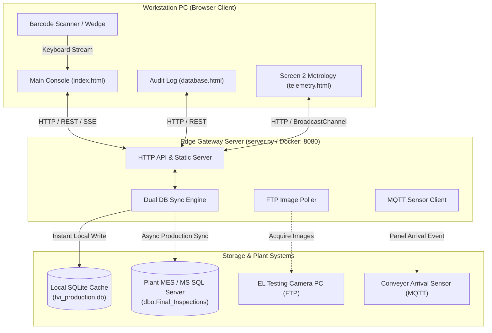

# Photovoltaic Final Visual Inspection (FVI) Console

[](.)
[](.)
[-f59e0b?style=flat-square)](.)
[](.)

An ultra-responsive, zero-latency manufacturing workstation interface and edge gateway designed for solar module **Final Visual Inspection (FVI)** lines. The console pairs high-resolution Electroluminescence (EL) imagery with a calibrated 24×6 coordinate overlay, allowing shop-floor quality inspectors to rapidly identify micro-cracks, tag cell-level defects from a standardized 55-preset IEC catalog, enforce grading compliance rules, and stream structured records directly to plant databases.

---

## Table of Contents

1. [System Overview](#system-overview)
2. [Key Capabilities & Features](#key-capabilities--features)
3. [Architecture](#architecture)
4. [Getting Started (How to Run)](#getting-started-how-to-run)
   - [Method 1: Docker Compose (Recommended)](#method-1-docker-compose-recommended)
   - [Method 2: Standalone Python (Local / Offline)](#method-2-standalone-python-local--offline)
5. [Configuration (.env)](#configuration-env)
6. [Operator Workflow & User Guide](#operator-workflow--user-guide)
7. [Defect Catalog & Grading Rules](#defect-catalog--grading-rules)
8. [Keyboard Shortcuts](#keyboard-shortcuts)
9. [Database Schema & Data Flow](#database-schema--data-flow)
10. [API Reference](#api-reference)
11. [Troubleshooting](#troubleshooting)

---

## System Overview

During photovoltaic module assembly, finished panels undergo Electroluminescence (EL) testing before final packaging. The FVI Console runs on workstation PCs positioned at the end of the line, providing inspectors with an ergonomic, high-contrast, distraction-free environment:

- **1:1 Calibrated 24×6 Cell Overlay**: Maps directly over 144 half-cut monocrystalline/polycrystalline silicon cells (Rows `A`–`F`, Columns `1`–`24`).
- **Standardized Coordinate Format**: Uniform cell naming format (`Cell B4`, `B4`) with zero hyphens or ambiguous zero-padding.
- **Bi-Directional Inspection**: Instant toggling between **Front Side** (cells, ribbons, glass) and **Back Side** (backsheet, junction boxes).
- **Rule-Enforced Module Grading**: Eliminates human grading errors by cross-checking tagged defect severity against plant quality standards (`0 = Grade A`, `1 = Grade B`, `2 = Retest/Rework`, `3 = Reject`).
- **One-Touch Reset Cycle**: Submitting a grade saves the record, clears tagged defects, and refocuses the scanner input for the next module.
- **Dedicated Audit Log**: Web-based database portal (`database.html`) for searching historical records, viewing defect distributions, and exporting CSV audits.

---

## Key Capabilities & Features

### 1. Calibrated EL Matrix Stage
- Seamless 24×6 grid perfectly registered to physical cell dimensions.
- High-contrast crosshair reticle following the cursor.
- Instant cell hover feedback (`Cell B4`) showing active defect status.
- **Invert Filter (<kbd>I</kbd>)**: One-click high-contrast inversion filter to highlight hairline micro-cracks, dark cells, and solder voids.

### 2. Standardized 55-Defect Plant Catalog
- Popover speech bubble triggers on cell click with categorized tabs: **Glass**, **Frame**, **Cell**, **EVA**, **Backsheet**, **Junction Box**, **Soldering**, **Module Dimension & Appearance**, and **Other**.
- Live instant search filter by code or name.
- Single neutral design style with zero confusing side-color codes.
- Immediate database persistence upon defect confirmation.

### 3. Smart Grading Compliance
- Grading buttons:
  - **`[ A ]` Prime / Pass** (Stored as `0` in database)
  - **`[ B ]` Secondary** (Stored as `1` in database)
  - **`[ R ]` Retest / Rework** (Stored as `2` in database)
  - **`[ X ]` Reject / Scrap** (Stored as `3` in database)
- **Automatic Restriction Engine**: If a defect with strict grade limits is logged (e.g. `O3 Low Power` which only permits `Rework` or `Reject`), Grade `A` and `B` buttons are locked out and visually struck through.

### 4. Hardware Scanner & Clipboard Interceptors
- **Hardware Wedge Interceptor**: Intercepts high-speed barcode scanner streams starting with `USM` (16 characters) and automatically routes them to the Serial ID field, regardless of current cursor focus.
- **Global Paste Interceptor**: Any clipboard paste containing a module serial is parsed, cleaned, and assigned directly to the module input.

### 5. Asymmetric Split Dock
- **Top Section (~34%)**: Logged defects for the active module (`CELL` | `SIDE` | `CODE` | `DEL`) with full description tooltips on hover.
- **Bottom Section (~66%)**: Real-time grading history stream in reverse chronological order. Clicking any previous module re-loads its image and queries its logged defects.
- **Dock Toggle (`[ ◫ Dock ]` / Hotkey <kbd>[</kbd> or <kbd>D</kbd>)**: Collapses the dock to accommodate split-screen or 16:9 monitor setups.

---

## Architecture



---

## Getting Started (How to Run)

### Prerequisites
- **For Docker**: [Docker Desktop](https://www.docker.com/products/docker-desktop/) (Windows/macOS) or Docker Engine + Docker Compose (Linux).
- **For Standalone**: Python 3.9+ installed on the host system.

---

### Method 1: Docker Compose (Recommended)

Running with Docker ensures complete isolation, correct dependencies, and automated restart on boot.

1. **Clone or navigate to the project directory**:
   ```bash
   cd "c:\Users\megam\OneDrive\문서\US Modules\finalinspection"
   ```

2. **Verify or create your `.env` configuration**:
   ```bash
   cp .env.example .env
   ```
   *(By default, `.env` runs in offline/local SQLite mode without requiring external servers.)*

3. **Build and launch the container**:
   ```bash
   docker compose up --build -d
   ```

4. **Verify container status**:
   ```bash
   docker compose ps
   ```
   You should see `fvi_inspection_server` running on port `8080:8080`.

5. **Open in browser**:
   - **Main FVI Console**: [http://localhost:8080](http://localhost:8080)
   - **Database Audit Log**: [http://localhost:8080/database.html](http://localhost:8080/database.html)
   - **Secondary Telemetry**: [http://localhost:8080/telemetry.html](http://localhost:8080/telemetry.html)

6. **To stop the server**:
   ```bash
   docker compose down
   ```

---

### Method 2: Standalone Python (Local / Offline)

The server can run natively using Python's built-in standard library with **zero required external packages** for basic operation:

1. **Install optional driver dependencies** (only if connecting to live MS SQL Server or MQTT):
   ```bash
   pip install -r requirements.txt
   ```

2. **Start the Edge Server**:
   ```bash
   python server.py
   ```
   *Output:*
   ```text
   ================================================================================
   FVI Station 01 — Photovoltaic Final Visual Inspection Console
   Turnkey Manufacturing Edge Gateway
   ================================================================================
   [*] Edge Gateway listening on: http://0.0.0.0:8080
   [*] Local SQLite Cache: C:\...\finalinspection\fvi_production.db
   [+] Database initialized successfully.
   ```

3. **Access the Console**:
   Open Google Chrome or Microsoft Edge and navigate to:
   `http://localhost:8080`

---

## Configuration (.env)

All integration settings are managed through environment variables in `.env`:

| Variable | Default | Purpose |
| :--- | :--- | :--- |
| `SERVER_HOST` | `0.0.0.0` | Server bind IP address |
| `SERVER_PORT` | `8080` | Server HTTP port |
| `CMMS_MODE` | `sqlite` | Auth mode: `sqlite` (local), `external_rest`, or `external_sql` |
| `MSSQL_ENABLED` | `false` | Enable/disable direct sync to Microsoft SQL Server |
| `MSSQL_SERVER` | `localhost` | MS SQL Server hostname or IP |
| `MSSQL_DATABASE` | `PL2` | Production MES database name |
| `MSSQL_USER` | `Final_Inspection` | SQL authentication username |
| `MSSQL_PASSWORD` | `...` | SQL authentication password |
| `FTP_ENABLED` | `false` | Enable automatic EL image fetching from tester PC |
| `FTP_HOST` | `192.168.1.150` | IP address of the EL test machine |
| `FTP_REMOTE_DIR` | `/EL_Captures` | Remote directory where the camera saves images |
| `MQTT_ENABLED` | `false` | Enable conveyor panel arrival trigger events |
| `MQTT_BROKER` | `localhost` | MQTT broker hostname |
| `MQTT_TOPIC` | `factory/conveyor/fvi/station1/panel` | MQTT topic for arrival notifications |

> [!NOTE]
> When `MSSQL_ENABLED=false`, the server automatically defaults to local high-speed SQLite storage (`fvi_production.db`). When enabled, records are saved to **both** local SQLite (for zero-latency UI rendering) and the enterprise MS SQL Server tables.

---

## Operator Workflow & User Guide

```text
[ 1. Operator Login ] ──> [ 2. Scan Serial ] ──> [ 3. Visual & EL Inspection ]
                                                              │
                                            ┌─────────────────┴─────────────────┐
                                            ▼                                   ▼
                                   [ Front Side (Cells) ]              [ Back Side (J-Box) ]
                                            │                                   │
                                            └─────────────────┬─────────────────┘
                                                              ▼
                                                    [ 4. Tag Cell Defects ]
                                                              │
                                                              ▼
                                                    [ 5. Select Grade ]
                                                              │
                                                              ▼
                                                  [ 6. Submit Inspection ]
                                                              │
                                            ┌─────────────────┴─────────────────┐
                                            ▼                                   ▼
                                   [ Records Saved to DB ]           [ Console Cleared ]
                                                                                │
                                                                                ▼
                                                                     [ Ready for Next Panel ]
```

1. **Sign In**: Click the inspector badge in the top rail. Enter your **First Name Last Name** to bind your name to inspection logs.
2. **Scan Module**: Use a handheld scanner or paste a 16-character serial starting with `USM` (e.g. `USM0121910260002`). The console loads the calibrated EL image.
3. **Inspect Front & Back**:
   - Inspect the front face for cell cracks, dead fingers, and soldering defects.
   - Press <kbd>F</kbd> or click **`[ BACK SIDE ]`** to inspect the backsheet and junction box.
   - Press <kbd>I</kbd> to invert contrast if checking for hairline micro-cracks.
4. **Tag Defects**: Click any cell (e.g. `B4`). A popover appears:
   - Select the defect code (e.g. `G2 Glass Scratch` or `C8 Cell Scratch`).
   - Press <kbd>Enter</kbd> to confirm. The defect pin immediately appears on the grid and logs in the top-left table.
5. **Assign Grade**: Select **`[ A ]`**, **`[ B ]`**, **`[ R ]`**, or **`[ X ]`** based on module quality. If a defect restricts allowed grades, disallowed options will be disabled.
6. **Submit Grade**:
   - Click **`Submit Grade`** or press <kbd>Enter</kbd> (when no popup is open).
   - The grade is saved to the database.
   - The logged defects and grid pins are cleared immediately, and the serial input is refocused for the next module.

---

## Defect Catalog & Grading Rules

The console incorporates standard manufacturing defect codes categorized across the solar module structure:

| Category | Examples | Allowed Grades |
| :--- | :--- | :--- |
| **Glass** | `G1` Surface Appearance, `G2` Glass Scratch, `G3` Glass Bubbles | `A`, `B`, `Retest` |
| **Frame** | `F1` Scratches, `F2` Dents, `F5` Burrs, `F6` Seam Gap, `F8` Ground Mark | `A`, `B`, `Retest` |
| **Cell** | `C1` Type Mixing, `C2` Color Diff, `C6` Corner Chip, `C7` Crack Separation, `C8` Cell Scratch | `A`, `B`, `Retest` |
| **EVA** | `E1` Voids/Bubbles, `E2` Wrinkles, `E4` Missing EVA, `E6` Foreign Material, `E7` White EVA Overflow | `A`, `B`, `Retest`, `Rework` |
| **Backsheet** | `B1` Delamination, `B2` Drums, `B3` Scratch, `B4` Fold, `B5` Indentation | `A`, `B`, `Retest` |
| **J-Box** | `J1` Body Damage, `J2` Installation, `J3` Wires & Connectors, `J5` Potting | `A`, `Retest`, `Rework` |
| **Soldering**| `S1` Offset Soldering, `S2` Solder Scar, `S3` Busbar Soldering | `A`, `Retest`, `Rework` |
| **Dimension**| `D1`–`D8` Dimensions, Alignment, Chamfer, Grid Print, `D9` Barcode, `D10` Nameplate | `A`, `B`, `Retest`, `Rework` |
| **Other** | `O1` No EL Data, `O2` No Power, `O3` Low Power, `O4` High Power | `Retest`, `Rework`, `Reject` *(Blocks A & B)* |

---

## Keyboard Shortcuts

| Shortcut | Action |
| :---: | :--- |
| <kbd>A</kbd> | Set module grade to **Grade A (Prime)** |
| <kbd>B</kbd> | Set module grade to **Grade B (Secondary)** |
| <kbd>R</kbd> | Set module grade to **Retest / Rework** |
| <kbd>X</kbd> | Set module grade to **Reject / Scrap** |
| <kbd>Enter</kbd> | **In defect popup**: Confirm & save defect<br>**On main stage**: Submit module grade to database & clear for next module |
| <kbd>1</kbd>&ndash;<kbd>8</kbd> | Quick-select defect reason item from visible catalog list |
| <kbd>F</kbd> | Toggle between **Front Side** and **Back Side** view |
| <kbd>I</kbd> | Toggle **Invert** image contrast filter |
| <kbd>[</kbd> or <kbd>]</kbd> or <kbd>D</kbd> | Toggle Left Dock (Logged Defects & Grading History) |
| <kbd>M</kbd> | Toggle Stage View Mode (Split / Full Stage) |
| <kbd>Esc</kbd> | Close defect bubble, popover, or active modal |

---

## Database Schema & Data Flow

Inspection records are structured to align directly with enterprise MES and SQL Server reporting tables:

### 1. Table: `final_inspections` (dbo.Final_Inspections)
Stores final module classification and tester audit logs:
```sql
CREATE TABLE final_inspections (
    record_id INTEGER PRIMARY KEY AUTOINCREMENT,
    module_id VARCHAR(16) NOT NULL,
    tested_at TIMESTAMP DEFAULT CURRENT_TIMESTAMP,
    grade VARCHAR(1) NOT NULL,      -- '0' = A, '1' = B, '2' = Retest/Rework, '3' = Reject
    result_code VARCHAR(1),         -- Compatible legacy grade alias
    tester_name TEXT NOT NULL
);
```

### 2. Table: `final_inspection_defects` (dbo.Final_Inspection_Defects)
Stores cell-level defects tagged during the inspection:
```sql
CREATE TABLE final_inspection_defects (
    record_id INTEGER PRIMARY KEY AUTOINCREMENT,
    module_id VARCHAR(16) NOT NULL,
    tested_at TIMESTAMP DEFAULT CURRENT_TIMESTAMP,
    defect_location VARCHAR(4),     -- Unified format: 'B4', 'A12', etc.
    defect_cell VARCHAR(4),         -- Alias for backward compatibility
    defect_type VARCHAR(30) NOT NULL,
    tester_name TEXT NOT NULL,
    side VARCHAR(10) DEFAULT 'front' -- 'front' or 'back'
);
```

---

## API Reference

The edge gateway exposes a lightweight REST API on port `8080`:

| Method | Endpoint | Description |
| :--- | :--- | :--- |
| `GET` | `/api/status` | Edge gateway health, DB connection status, and service uptime |
| `GET` | `/api/inspections` | Query grading history (`?limit=50&search=USM...&grade=0`) |
| `POST` | `/api/inspections` | Commit overall module grading record (`module_id`, `grade`, `tester_name`) |
| `GET` | `/api/defects` | Query logged defects for a module (`?module_id=USM...`) |
| `POST` | `/api/defects` | Instantly log a cell defect (`module_id`, `defect_location`, `defect_code`, `side`) |
| `POST` | `/api/defects/delete` | Remove a defect from a cell (`module_id`, `cell_coord`) |
| `GET` | `/api/module/:id/el-image` | Fetch calibrated EL image for specified module and side (`?side=front\|back`) |
| `POST` | `/api/auth/login` | Authenticate CMMS operator (`name`) |
| `GET` | `/api/events` | Server-Sent Events (SSE) stream for real-time panel arrival and grading broadcasts |

---

## Troubleshooting

### 1. Database Status says `STANDALONE` instead of `DB LIVE`
- **Cause**: The server is running in local offline cache mode using SQLite (`fvi_production.db`).
- **Solution**: This is normal for standalone operation. If connecting to a plant MS SQL Server, verify that `MSSQL_ENABLED=true` in `.env` and that port `1433` is accessible from the edge server.

### 2. EL Camera Image Shows "NOTICE: Example Image"
- **Cause**: The current module serial has not yet been transferred from the camera PC or FTP is disabled (`FTP_ENABLED=false`).
- **Solution**: The console gracefully falls back to bundled calibrated sample images (`sample_el_1.jpg`, `sample_el_back.jpg`) so testing can continue uninterrupted. To enable live transfer, set `FTP_ENABLED=true` in `.env`.

### 3. Container Fails to Start on Port 8080
- **Cause**: Another service or process is already using port `8080`.
- **Solution**: Update the port mapping in `docker-compose.yml`:
  ```yaml
  ports:
    - "8081:8080"
  ```
  Then access the console at `http://localhost:8081`.

### 4. Inspector Forgot to Log Out at Shift End
- Operators can switch accounts at any time by clicking the operator badge in the top navigation rail, selecting **Switch User / Sign Out**, and entering the new operator's name.

---

## File Structure

```text
finalinspection/
├── app.js                 # Core client application logic, grid matrix, defect rules, hotkeys
├── config.js              # Client configuration & API endpoint references
├── database.html          # Full historical grading & defect audit portal
├── index.html             # Primary FVI inspection workstation interface
├── styles.css             # High-contrast industrial UI stylesheet (dark mode)
├── telemetry.html         # Secondary display metrology & line statistics screen
├── telemetry.js           # Metrology display logic
├── telemetry.css          # Metrology display stylesheet
├── server.py              # Lightweight Edge Gateway Server (Python standard library)
├── fvi_production.db      # Local SQLite persistent database
├── docker-compose.yml     # Docker Compose orchestration
├── Dockerfile             # Multi-stage container definition
├── requirements.txt       # Optional external drivers (MSSQL, MQTT)
├── .env.example           # Environment template with plant connection settings
├── .env                   # Active environment variables
└── README.md              # Project documentation
```

---

**Developed for Plant Quality Operations & Final Inspection Lines.**
For support or customization requests, contact the Manufacturing Automation and Quality Engineering Team.

